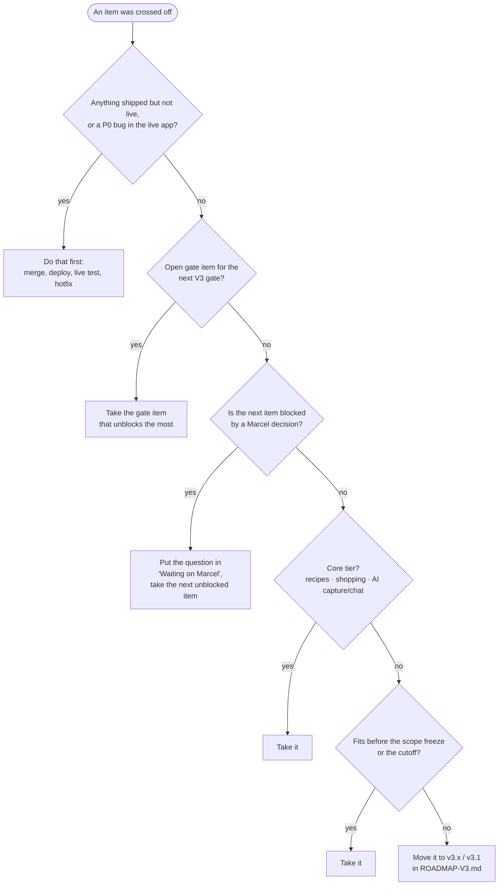

# 🍳 Koch — Roadmap index

> Start here. This page says **what is next** and where everything else lives.
> **Last updated: 2026-10-27** (refinement: G2.1 + P8.1 ready · v2.15b merged · v2.16 AI housekeeping built · v2.16.2 sync follow-ups + v2.17 find recipes built, PRs open) · Live: **v2.15b** (its database migration still needs one manual step; v2.16 goes live on merge)

## The two roadmaps

| File | Covers | Boundary |
|------|--------|----------|
| **[ROADMAP-V2.md](ROADMAP-V2.md)** | The **v2.x line**: features + the foundation V3 needs, until V3 launches and v2 becomes the fallback | Ships on today's address and architecture, carries over into V3 unchanged |
| **[ROADMAP-V3.md](ROADMAP-V3.md)** | The **V3 line**: v3.0 infrastructure release (domain, Play Store, production backend, clean-up, onboarding), then v3.1, v3.x, v3.5/v4, someday | Needs the new domain, the Play build or the clean-up, or Marcel scheduled it after v3.0 |

Background and reasoning for V3: [`docs/v3/`](docs/v3/README.md). New idea after the scope freeze
(31 Dec 2026)? → `ROADMAP-V3.md`, tagged v3.x.

---

## The road to V3 at a glance

| When | V2 line | V3 line |
|------|---------|---------|
| **Oct 2026** | ✅ v2.14 friends link live (4 Oct) · ✅ e2e tests (12 Oct) + v2.14.1 hotfix · ✅ **v2.15** one sync core (19 Oct) · ✅ **v2.15.1** safe recipe sync · ✅ **v2.15.2** list data safety · ✅ **v2.15.3** list identity + Lager rules · ✅ **v2.16b** shopping list clarity (pulled forward from Nov) · ✅ **v2.15b** backend hardening (pulled forward from Nov) · ✅ **v2.16** AI housekeeping (built, pulled forward from Nov) · two-account sharing proof | ✅ Decisions D8, A10, D9, A11, E6, G7 answered (4 Oct) · open: D10, C7 availability |
| **Nov 2026** | ✅ **v2.17** find recipes faster (built 27 Oct) · **v2.18** export/import · ★ **R1 data-model spike** (ingredient model, format 4) | Long-lead: domain (Citchen), Play account, 12 testers |
| **Dec 2026** | **v2.19** ingredient master + calories | Spikes (TWA, sign-in, photos, **backend + hosting**) · ADRs · V3 plan · **scope freeze 31 Dec** |
| **Jan–Mar 2027** | **v2.19b** structured recipe editor + capture · **v2.20** assistant edits recipes + editable instructions · **v2.21** move helper + English format/UI (before the domain switch) · v2.22+ small wins if time | **v3.0-a1 … a9** = slices 1, **1b backend**, 2–7, 9 (slice 8 moved to v3.x) · closed test from slice 3 |
| **Apr 2027** | Fixes only | **v3.0 launch, target 30 Apr** |
| **May 2027** | 30-day read-only fallback | Buffer · **hard cutoff 31 May** → leftovers to v3.1 |
| **H2 2027** | Retired | v3.1 · v3.x (shared cookbook, spend display, longevity cards …) |

---

## ▶ Recommended next

The queue always holds the next **5** items across both lines, in order. Re-ranked with the flow
below every time an item is crossed off.

| # | Item | Line | Owner | Why now | Effort | Unblocks |
|---|------|------|-------|---------|--------|----------|
| 1 | **Merge PR #18 (v2.16.2) and the v2.17 PR, finish the v2.15b steps + device checks** (v2.16 is merged) | V2 | Marcel (Claude guides) | Live beats new (rule 1). **v2.15b:** ✅ migration applied on prod + ✅ advisors checked (26 Oct: the 18 expected `fl_*` warnings, nothing else) · GitHub → Actions → "Supabase keep-alive" → *Run workflow* once (green = keep-alive works) · friends link still works. **v2.16:** build line v2.16 · capture check (Q1): 10 real recipes — ~6 photos (book page, handwritten, screenshot) + ~4 URLs; each draft complete and faithful? · ask the assistant twice → Settings → KI → „Verbrauch“ shows both calls (and „aus Cache“ > 0 % if the cookbook is big enough). **v2.16b:** Thai curry → result sheet → rows say „aus Thai-Style Gemüsecurry“, ✕ + „Rückgängig“, tiles stay under your finger. **v2.17:** sort menu right in the search field → pick „Zuletzt gekocht“, close and reopen the app → still selected · search „linsen spinat“ → only recipes with both | 40 min | P7, Q1 closed · FR-01 closed |
| 2 | **Live friend test** (V2 P4) — PR #8 merged 2026-10-04 | V2 | Marcel | The backend piece should be proven with a real friend before it is hardened (P7). Now unblocked: the list code it writes into is fixed (v2.15.2) | 15 min | P7, closes I3 |
| 3 | **Two-account sharing proof** (V2 P3): Picker API key, partner as test user, run the test in `v2/docs/SHARING.md` | V2 | Marcel (Claude guides) | **Last open V3 gate item** (P1 ✅, P2 ✅). The e2e suite proves the flow with fake accounts; this is the real-phone proof — now on a clean list | ~45 min | V3 gate, US-06 |
| 4 | **v2.18 — recipe export / import** (V2 G2, split 2026-10-27: **G2.1 import core = ready**; G2.2/G2.4 planned, questions answered; **P8.1** i18n clean-up is also ready and can ride along) | V2 | Claude | Next in the version plan; a portable file is also the safety net before format 4 (R1) | S–M | R1 spike |
| 5 | ★ **R1 data-model spike** (ingredient model, unit spec, format 4) | V2 | Claude (+ Marcel signs off) | Gates v2.19 (ingredient master + calories) and P6/format 4; due in Nov before format 4 is frozen. Also the right moment for the vegetarian/vegan flag skipped in v2.17 | M | v2.19, P6 |

**Waiting on Marcel — from the QA fleet (2026-10-12), each a yes/no:**
*All answered:* T5 ✅ yes and T6 ✅ yes (26 Oct, built in v2.15.3) · T3 and T12 settled by v2.15.1 without a decision.

*Answered 2026-10-27:* G2-Q1…Q3 (Markdown always English), G3-Q1/Q2, Q4-Q1/Q2, P8-Q1 — all as suggested; items are `planned` and get promoted as the ready buffer frees up.

**Waiting on Marcel — from v2.16, a yes/no:** **Q5** move the chat to the 5.5 generation? Haiku 5.5 is ~10× cheaper than today's Haiku 4.5 default and caches from 512 tokens (so v2.16's prompt caching hits for every cookbook size); Sonnet 5.5 would replace Sonnet 4.6 as the stronger option. Recommended: yes, after the v2.16 usage numbers are in (details: `ROADMAP-V2.md` Q5).

**Waiting on Marcel — 5-minute answers that unblock the queue** (details in `ROADMAP-V3.md` §6):
**D10** timing: accounts + recipe sharing in v3.0 or first in v3.x (recommended: v3.x) · **D11** sharing = send/invite, not public (recommended) · **R1** sign-off on the ingredient/unit spec (Nov) · **L1 nutrition** now resolved by R2, please confirm ·
**C7** check `citchen.app` / `citchen.de` availability, then buy. *Answered 2026-10-04 and now unblocked:*
G7 → v2.17 · E6 + A11 → v2.20 · D8 English → v2.21 · A10 → v3.x · D9 → P7 + slice 1b · C-20 same repo.

---

## How the next item is chosen (recommendation flow)

**The rules behind it, in priority order**
1. **Live beats new.** Something built but not deployed or not verified on a real device comes first.
2. **Gates beat features.** Items that gate the next V3 gate (currently V2 P1–P3) come before anything else.
3. **Decisions are cheap, waiting is expensive.** A blocked item is never "next"; its question goes to Marcel instead, and the next unblocked item moves up.
4. **Core tier first.** Recipes + cooking mode, shopping list, AI capture and chat beat plan, stock and extras (usage tiers in `docs/v3/00-INTENT-AND-USER-STORIES.md`).
5. **Fits the week.** One release = one 2–3 h test session for Marcel. Split anything bigger.
6. **Dates win.** What can't make the scope freeze (31 Dec 2026) or the cutoff (31 May 2027) moves out, it doesn't stretch the date.

---

## Update rule — when an item is crossed off

Part of every release's definition of done (Claude Code does this; the release-captain agent checks it):

1. **Roadmap file:** mark the item ✅ with version + date. V2: move it to the shipped log. V3: set the status in its table.
2. **Version plan:** set that version's status to ✅; re-date later rows if something slipped.
3. **This page:** remove the item from **Recommended next**, run the flow, refill the queue to 5, update "Last updated" and the "at a glance" table if dates moved.
4. **docs/v3:** if the item closes a check (C-x) or story (US-x), tick it in `docs/v3/03-QUESTIONS.md`.
5. **Marcel answered a question:** record the answer in the roadmap row and in `docs/v3/03-QUESTIONS.md` Part 3, then unblock the dependent item.

---

## Other planning files

| File | What it is |
|------|------------|
| [`docs/v3/`](docs/v3/README.md) | V3 preparation package: intent, user stories, decisions D1–D10, questions, risks, learning track |
| [`v2/docs/SHARING.md`](v2/docs/SHARING.md) | How partner sharing and the friends link work + test steps |
| [`qa/FLEET-REPORT.md`](qa/FLEET-REPORT.md) | QA agent findings; promoted into a roadmap by hand (2026-10-12 run → V2 Epic T) |
| [`qa/FIELD-REPORTS.md`](qa/FIELD-REPORTS.md) | What you saw on a real device (`FR-NN`); the QA fleet root-causes these first |
| `.planning/ROADMAP.md` | Working file of the planning tool for the finished shared-list phase (v2.10). Not a product roadmap. |
| `SCHEMA.md` | The `rezepte.json` contract |

---

## QA audit findings *(automated audit 2026-10-27 — proposed, not yet ranked into the queue)*

Status of every item: **proposed**. Audit run: unit suite 358/358 green, e2e 46/46 green, no lint / type-check / build step exists in the repo (so none was run). Evidence is from `main` @ `7550c35`.

| ID | Title | Severity | Evidence | Acceptance criteria |
|----|-------|----------|----------|---------------------|
| **QA-01** | **No CI runs the test suites on PRs or `main`** — status: proposed | medium | `.github/workflows/` holds only `supabase-keepalive.yml`; `node v2/tests/run.js` (358 tests) and `npm --prefix v2/e2e test` (46 tests) run only on a developer machine. The last 10 merges to `main` (`git log --since="7 days ago"`) each relied on the author's local run. | A workflow triggers on `pull_request` and `push` to `main`, runs `node v2/tests/run.js` and the Playwright suite, and fails the check on any test failure. Proven by one PR that deliberately breaks a test showing a red check (then reverted). |
| **QA-02** | **Sort "last cooked" ranks non-German month names as "month 0"** — status: proposed | low | `v2/src/features/cookbook/filter.js` `cookedMonthKey`: probe `cookedMonthKey("May 2026")`, `"mayo 2026"`, `"maj 2026"`, `"Mär 2026"`, `"Okt. 2026"` all return `202600` (year only), so those recipes sort below any recipe from an earlier year's full month. The app always writes German (`detail.js` `toLocaleDateString("de-DE")`), but `SCHEMA.md` lets project-Claude / v1 / imports write `lastCooked` as free text. | `cookedMonthKey` returns the right `YYYYMM` for English, Spanish and Danish month names and for 3-letter / dotted German abbreviations ("Mär 2026", "Okt. 2026"); new cases in `v2/tests/test-filter.js`; `SCHEMA.md` states the accepted formats for `lastCooked`. |
| **QA-03** | **Roadmap index is stale after the v2.16.2 / v2.17 merges** — status: proposed | low | `ROADMAP.md` header ("PRs open", "Live: v2.15b") and queue item #1 ("Merge PR #18 … and the v2.17 PR"); `git log` shows PR #18 (`9f073e6`) and PR #19 (`7550c35`) already merged, and `ROADMAP-V2.md` version-plan rows still say "deploy = merge". | Header, "at a glance" table, queue item #1 and the `ROADMAP-V2.md` version-plan rows state what is actually merged and live; per the update rule in this file, the queue is refilled to 5. |
