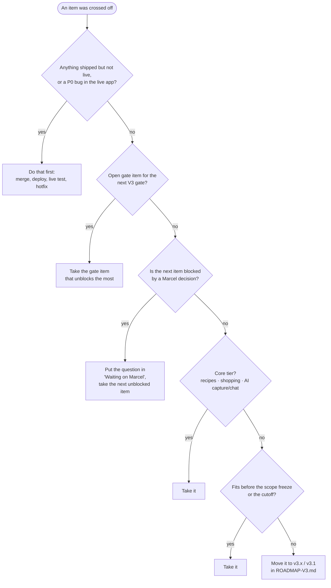

# 🍳 Koch — Roadmap index

> Start here. This page says **what is next** and where everything else lives.
> **Last updated: 2026-11-18** (replan with Marcel: **launch 26 Feb 2027**, closed test from **12 Dec**,
> domain switch **5 Dec**, scope freeze **15 Dec**, two releases a week; D10/D11 decided) · Live: **v2.18**
> (release PR #98 merged 18 Nov)

## The two roadmaps

| File | Covers | Boundary |
|------|--------|----------|
| **[ROADMAP-V2.md](ROADMAP-V2.md)** | The **v2.x line**: features + the foundation V3 needs, until the scope freeze (15 Dec 2026) | Ships on today's architecture and carries over into V3 unchanged |
| **[ROADMAP-V3.md](ROADMAP-V3.md)** | The **V3 line**: v3.0 (domain, Play Store, backend for feedback, onboarding, clean-up), then v3.1, v3.2 accounts, v3.x, v3.5/v4, someday | Needs the new domain, the Play build or the clean-up, or Marcel scheduled it after v3.0 |

Background and reasoning for V3: [`docs/v3/`](docs/v3/README.md). New idea after the scope freeze
(15 Dec 2026)? → `ROADMAP-V3.md`, tagged v3.1 or v3.x.

---

## The road to V3 at a glance *(replanned 2026-11-18)*

Why the dates moved: the agent pipeline now writes the code (23 PRs merged in October, 29 in the first
18 days of November; the v2.19 milestone was empty a month early), Marcel has 4–6 h/week, and the
12 testers, Play account and domain are in hand. Details: `ROADMAP-V3.md` §1 and §6.

| When | V2 line | V3 line |
|------|---------|---------|
| **Oct 2026** | ✅ v2.14 – v2.16b: friends link, e2e tests, one sync core, data-safety hotfixes, backend hardening, AI housekeeping | ✅ Decisions D8, A10, D9, A11, E6, G7 (4 Oct) |
| **Nov 2026** | ✅ v2.17 find recipes · ✅ **v2.18** export/import (live 18 Nov) · P3 + P4 phone tests (Marcel, week of 18 Nov) · **v2.20** assistant edits recipes (25 Nov) · **v2.19** ingredient master + `items[]` (28 Nov) | ✅ domain `citchen.de` · ✅ 12 testers · ✅ D10/D11 + replan (18 Nov) · Play identity check (pending) · spikes C-1/C-8/C-20 + ADRs (by 2 Dec) |
| **Dec 2026** | **v2.21** move helper (2 Dec) · **v2.19a** calories (9 Dec) · **v2.19b** structured editor + ownership (12 Dec) · **v2.19c** capture → master (16 Dec) · **v2.22** nutrition goal (19 Dec) | **v3.0-a1 domain switch Sat 5 Dec** (everyone moves; export 2–5 Dec) · **v3.0-a3 Android build → closed test starts Sat 12 Dec** · **scope freeze Tue 15 Dec** · 19 Dec – 6 Jan fixes only |
| **Jan 2027** | — (all releases are `v3.0-…`) | Apply for Play production access (~28 Dec – 4 Jan) · **a5** capture camera/share (9 Jan) · **a1b** feedback backend (13 Jan) · **a4** onboarding + home screen (20 Jan) · **a6** clean-up + feedback form (30 Jan) · partner feedback chat (G1) |
| **Feb 2027** | — | **b-builds**: tester fixes, store listing · **rc 20 Feb** · **v3.0 launch Fri 26 Feb** |
| **Mar 2027** | — | Buffer · **hard cutoff 31 Mar** · **v3.1** starts: format 4 / English data, default photos, Gesund hub, accessibility, iPhone |
| **Apr – Jun 2027** | — | v3.1 (Mar–Apr) · **v3.2 accounts + send/invite sharing** (May–Jun) · public recipes decision (May) |
| **H2 2027** | — | v3.x: public recipes + ratings, shared household cookbook/plan, spend display, longevity cards … |

---

## ▶ Recommended next

The queue always holds the next **5** items across both lines, in order. Re-ranked with the flow
below every time an item is crossed off.

| # | Item | Line | Owner | Why now | Effort | Unblocks |
|---|------|------|-------|---------|--------|----------|
| 1 | **v2.18 device checklist + P3 two-account proof + P4 live friend test** (this week) | V2 | Marcel (Claude guides) | Live beats new (rule 1) and gates beat features (rule 2): P3/P4 are the **last V2 gate items** before the domain switch on 5 Dec. v2.18 checks are in its release PR (#98); still open from earlier releases: v2.16 capture check on 10 real photos/URLs, keep-alive *Run workflow* once. P3 needs the Picker API key + partner as OAuth test user (`v2/docs/SHARING.md`) | ~1.5 h | V3 gate, US-06, closes I3 |
| 2 | **Finish the Play identity check · support e-mail on `citchen.de` · DNS access for GitHub Pages** | V3 | Marcel | Nothing else can start the 14-day clock on 12 Dec. Google's identity check can take days | ~30 min + waiting | Slice 1, slice 3 |
| 3 | **Assistant edits recipes** (G3.2 #73 — PR #87 has changes requested; then G3.3 #74) | V2 | Claude | Core tier; due Wed 25 Nov (v2.20) | S–M | v2.20 |
| 4 | **R2 ingredient master 70 → ~150 + R3 `items[]` on recipes** (Epic R, ADR R1 §8) | V2 | Claude | Due Sat 28 Nov (v2.19); gates calories (v2.19a), the editor (v2.19b) and capture mapping (v2.19c) | M–L | v2.19a–c |
| 5 | **P5 move helper** + spikes **C-1** (TWA on `citchen.de/app`), **C-8** (Google sign-in production), **C-20** (`/app` layout + github.io redirect) + ADRs D10 / D11 / hosting | V2 + V3 | Claude (+ Marcel signs off ADRs) | The domain switch on Sat 5 Dec redirects the whole old address; P5 must be live on 2 Dec so people can export first | M + S | Slice 1 (5 Dec), slice 3 (12 Dec) |

**Waiting on Marcel — 5-minute answers / actions:**
- **Release prep twice a week:** edit the *Citchen · Release retry* task (Wednesday 07:50) so it runs a full release prep, not only a retry (`docs/process/SCHEDULED-TASKS.md`). Until then releases stay weekly and the December dates slip.
- **Export window 2–5 Dec:** you, your partner and friends who use the app run „Umzug“ export on the old address before the switch.
- **G1:** your partner joins the closed test on iPhone; 15-min feedback chat in January.

*Answered 2026-11-18 (round 4, replan):* time 4–6 h/week · launch end of Feb · closed test from Dec ·
hub + default photos → v3.1 · format 4 → v3.1 (P6 dropped) · P3/P4 this week · two releases a week ·
D10 accounts = v3.2 · D11 public browsing + ratings later (decide May 2027) · app at `citchen.de/app` ·
Supabase Free until accounts · testers without AI by default · home screen + feedback form in v3.0 ·
freeze 15 Dec · M1–M3 in · switch own data in Dec · partner as tester, iPhone best-effort ·
*19 Nov:* v1 archived at the switch (no users) · GitHub milestones re-dated to this plan (new: v3.0-a1, v2.19a,
v3.0-a3, v2.19c, v2.22).
Full table: `ROADMAP-V3.md` §6. *Earlier rounds:* `docs/v3/03-QUESTIONS.md` Part 3.

---

## How the next item is chosen (recommendation flow)

**The rules behind it, in priority order**
1. **Live beats new.** Something built but not deployed or not verified on a real device comes first.
2. **Gates beat features.** Items that gate the next V3 gate (currently V2 P3–P5) come before anything else.
3. **Decisions are cheap, waiting is expensive.** A blocked item is never "next"; its question goes to Marcel instead, and the next unblocked item moves up.
4. **Core tier first.** Recipes + cooking mode, shopping list, AI capture and chat beat plan, stock and extras (usage tiers in `docs/v3/00-INTENT-AND-USER-STORIES.md`).
5. **Fits the slot.** One release = one ~1 h test session for Marcel, two a week (since 2026-11-18). Split anything bigger.
6. **Dates win.** What can't make the scope freeze (15 Dec 2026) or the cutoff (31 Mar 2027) moves out, it doesn't stretch the date.

---

## Update rule — when an item is crossed off

Part of every release's definition of done (Claude Code does this; the release-captain agent checks it):

1. **Roadmap file:** mark the item ✅ with version + date. V2: move it to the shipped log. V3: set the status in its table.
2. **Version plan:** set that version's status to ✅; re-date later rows if something slipped.
3. **This page:** remove the item from **Recommended next**, run the flow, refill the queue to 5, update "Last updated" and the "at a glance" table if dates moved.
4. **docs/v3:** if the item closes a check (C-x) or story (US-x), tick it in `docs/v3/03-QUESTIONS.md`.
5. **Marcel answered a question:** record the answer in the roadmap row and in `docs/v3/03-QUESTIONS.md` Part 3, then unblock the dependent item.

---

## Other planning files

| File | What it is |
|------|------------|
| [`docs/v3/`](docs/v3/README.md) | V3 preparation package: intent, user stories, decisions D1–D11, questions, risks, learning track |
| [`v2/docs/SHARING.md`](v2/docs/SHARING.md) | How partner sharing and the friends link work + test steps |
| [`qa/FLEET-REPORT.md`](qa/FLEET-REPORT.md) | QA agent findings; promoted into a roadmap by hand (2026-10-12 run → V2 Epic T) |
| [`qa/FIELD-REPORTS.md`](qa/FIELD-REPORTS.md) | What you saw on a real device (`FR-NN`); the QA fleet root-causes these first |
| `.planning/ROADMAP.md` | Working file of the planning tool for the finished shared-list phase (v2.10). Not a product roadmap. |
| `SCHEMA.md` | The `rezepte.json` contract |

---

## QA audit findings *(automated audit 2026-10-27 — proposed, not yet ranked into the queue)*

Status of every item: **proposed**. Audit run: unit suite 358/358 green, e2e 46/46 green, no lint / type-check / build step exists in the repo (so none was run). Evidence is from `main` @ `7550c35`.

| ID | Title | Severity | Evidence | Acceptance criteria |
|----|-------|----------|----------|---------------------|
| **QA-01** | **No CI runs the test suites on PRs or `main`** — status: proposed | medium | `.github/workflows/` holds only `supabase-keepalive.yml`; `node v2/tests/run.js` (358 tests) and `npm --prefix v2/e2e test` (46 tests) run only on a developer machine. The last 10 merges to `main` (`git log --since="7 days ago"`) each relied on the author's local run. | A workflow triggers on `pull_request` and `push` to `main`, runs `node v2/tests/run.js` and the Playwright suite, and fails the check on any test failure. Proven by one PR that deliberately breaks a test showing a red check (then reverted). |
| **QA-02** | **Sort "last cooked" ranks non-German month names as "month 0"** — status: proposed | low | `v2/src/features/cookbook/filter.js` `cookedMonthKey`: probe `cookedMonthKey("May 2026")`, `"mayo 2026"`, `"maj 2026"`, `"Mär 2026"`, `"Okt. 2026"` all return `202600` (year only), so those recipes sort below any recipe from an earlier year's full month. The app always writes German (`detail.js` `toLocaleDateString("de-DE")`), but `SCHEMA.md` lets project-Claude / v1 / imports write `lastCooked` as free text. | `cookedMonthKey` returns the right `YYYYMM` for English, Spanish and Danish month names and for 3-letter / dotted German abbreviations ("Mär 2026", "Okt. 2026"); new cases in `v2/tests/test-filter.js`; `SCHEMA.md` states the accepted formats for `lastCooked`. |
| **QA-03** | **Roadmap index is stale after the v2.16.2 / v2.17 merges** — status: proposed | low | `ROADMAP.md` header ("PRs open", "Live: v2.15b") and queue item #1 ("Merge PR #18 … and the v2.17 PR"); `git log` shows PR #18 (`9f073e6`) and PR #19 (`7550c35`) already merged, and `ROADMAP-V2.md` version-plan rows still say "deploy = merge". | Header, "at a glance" table, queue item #1 and the `ROADMAP-V2.md` version-plan rows state what is actually merged and live; per the update rule in this file, the queue is refilled to 5. |
